

 
  <h1>🎨 HEXCOLOR PRO v1.0.2</h1>
  
<b>Motor de Espacios de Color de Alto Rendimiento | Flutter + Rust + Kotlin</b>

  
  

    
    
    
    
    
  

  
   
   &nbsp;&nbsp;&nbsp;&nbsp;
   &nbsp;&nbsp;&nbsp;&nbsp;
  
    
  
  

---

# ✨ Características Principales

##   1. Motor Nativo en Rust (`rust_engine`)  

- **Aceleración C-ABI (FFI)**: Algoritmos de conversión matemática de color escritos en Rust para máximo rendimiento.

- **Espacios de Color**: Conversiones entre Hexadecimal (`#RRGGBB`), RGB, HSL, HSV y CMYK.

- **Simulación de Daltonismo**: Algoritmos de transformación espectral para Protanopia, Deuteranopia y Tritanopia.

- **Accesibilidad WCAG 2.1**: Cálculo del ratio de contraste en tiempo real con indicador PASS/FAIL para cumplimiento de estándares web y móviles.

- **Fallback Automático**: Fallback transparente en Dart si la librería nativa (`.dll` / `.so` / `.dylib`) no está presente.

---

# 🌙 2. Rueda HSL con Luna Interactiva (Modo Sombra)

- **Rueda de Color Interactiva**: Selección precisa mediante gestos en anillos de saturación y matiz.

- **Centro de Luna Tradicional/Sombra**: Tocar la luna en el centro de la rueda conmuta entre el modo de luz normal (`moon_light.png`) y el **Modo de Sombras** (`moon_shadow.PNG`), generando instantáneamente paletas de sombras y matices.
- **Modos de Armonía**:
  - Complementario
  - Triádico
  - Análogo
  - Tetrádico (Cuadrado / Rectangular)
  - Complementario Dividido
  - Monocromático
  - Sombras y Matices (Shades & Tints)
 

 
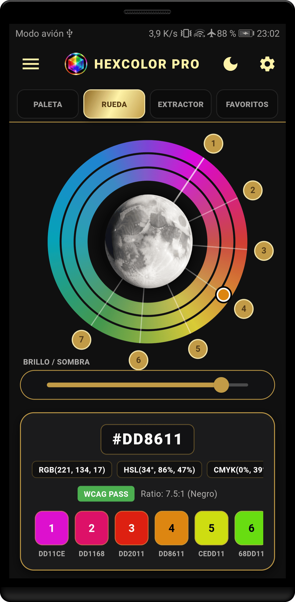&nbsp; 
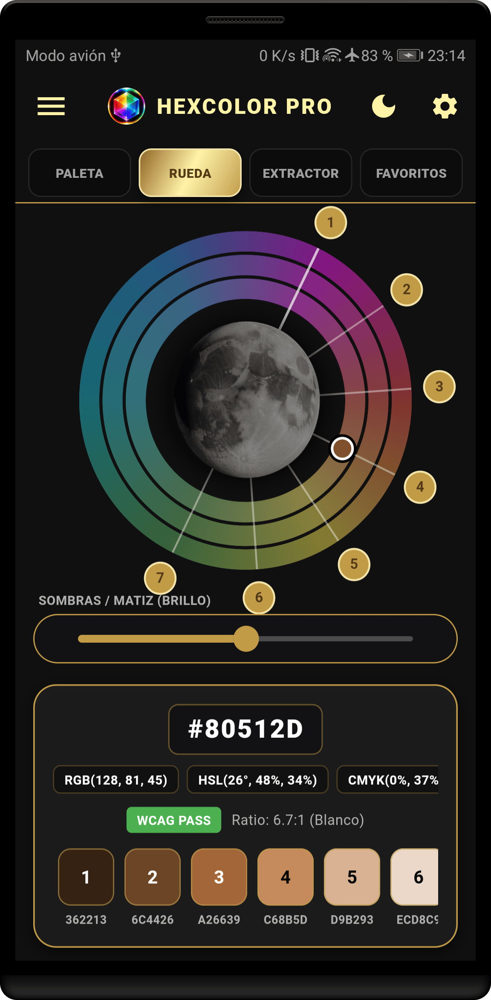&nbsp;
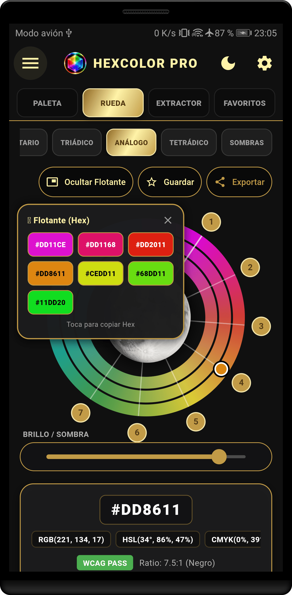&nbsp; 
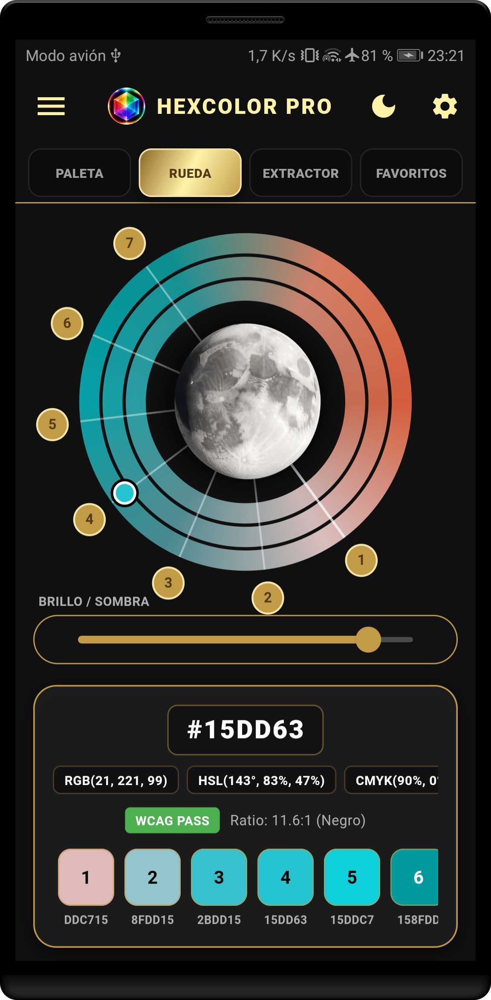&nbsp;   

---

# 🌓 3. Modo Claro y Modo Oscuro (Gold Theme)

- **Diseño Premium**: Paleta visual dorada adaptativa con sombras elegantes y bordes pulidos.

- **Tema Adaptativo**: Alterna en tiempo real entre un modo oscuro profesional y un modo claro radiante con fondos `#F4F5F8` y tarjetas blancas contrastadas.

 
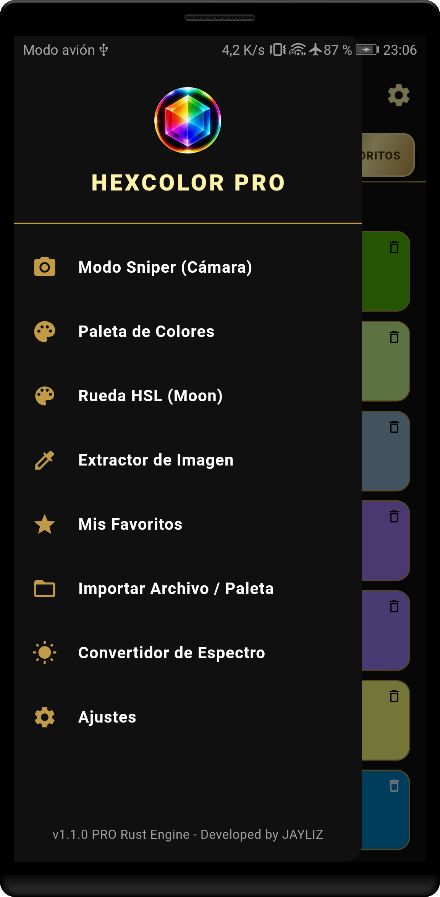&nbsp; 
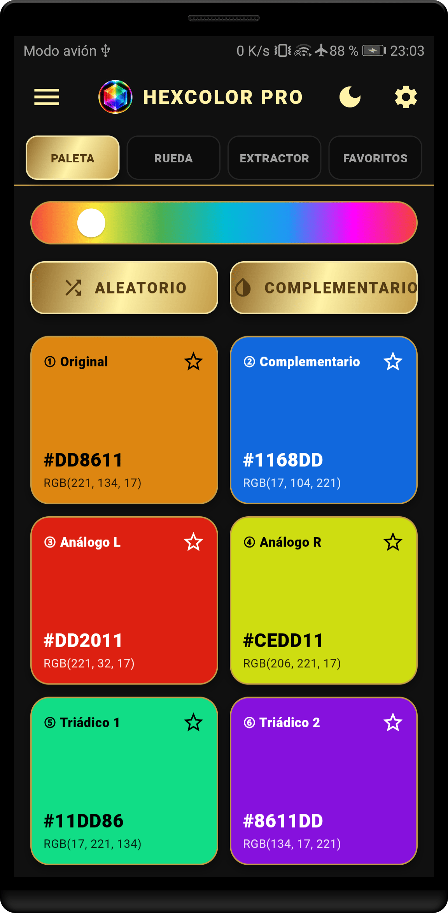&nbsp;&nbsp;&nbsp; 
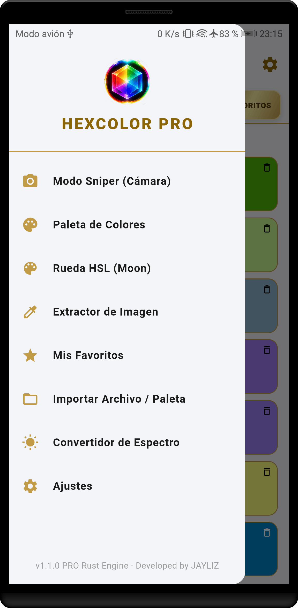&nbsp; 
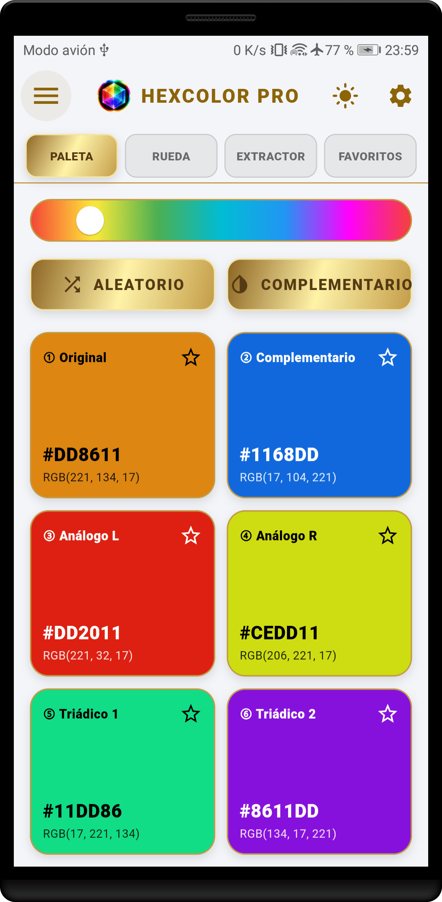&nbsp;   

---

# 👆 4. Navegación por Desplazamiento Táctil (Swipe)

- **Navegación Táctil**: Pasa entre las pestañas principales (**PALETA**, **RUEDA**, **EXTRACTOR**, **FAVORITOS**) deslizando el dedo horizontalmente.

- **Sincronización Total**: Animación fluida entre la barra de pestañas superior y el `PageView`.

---

# 📸 5. Extractor de Imagen y Modo Sniper (Cámara)

- **Camara Sniper en Vivo**: Retícula móvil en tiempo real para capturar cualquier color del mundo real directamente desde la cámara trasera.

- **Extractor de Paletas**: Carga imágenes desde la galería y extrae automáticamente los colores dominantes utilizando cuantización de imágenes.

 
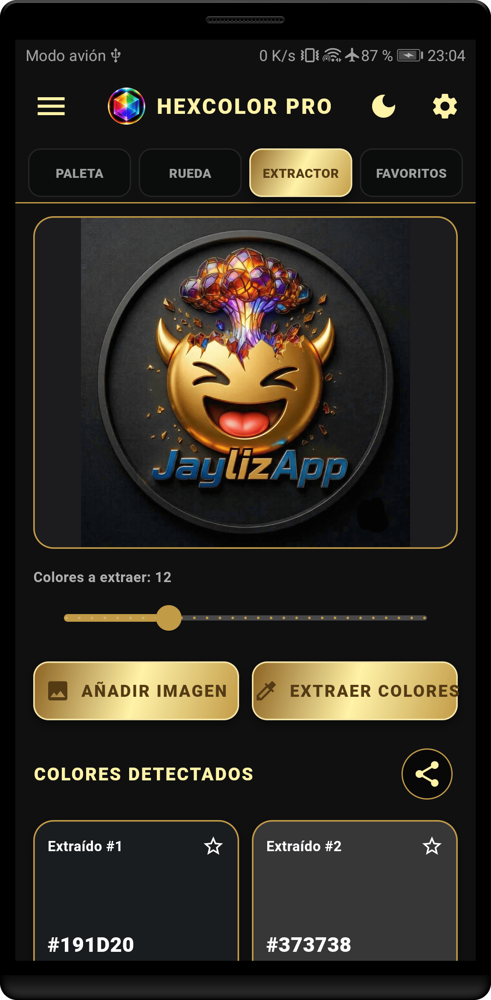&nbsp; 
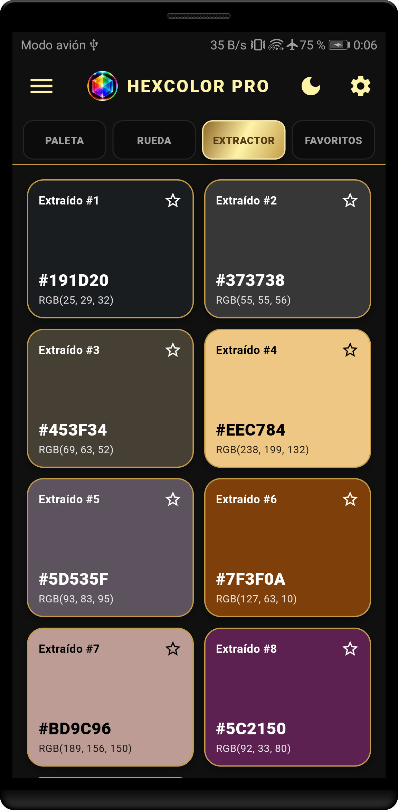&nbsp;&nbsp;&nbsp;
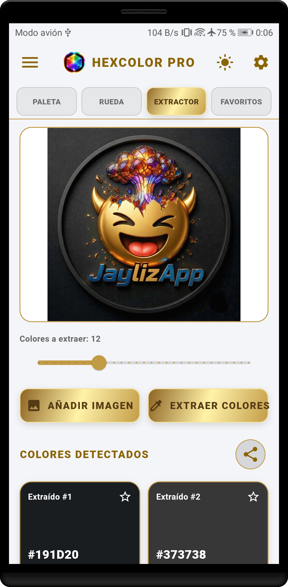&nbsp; 
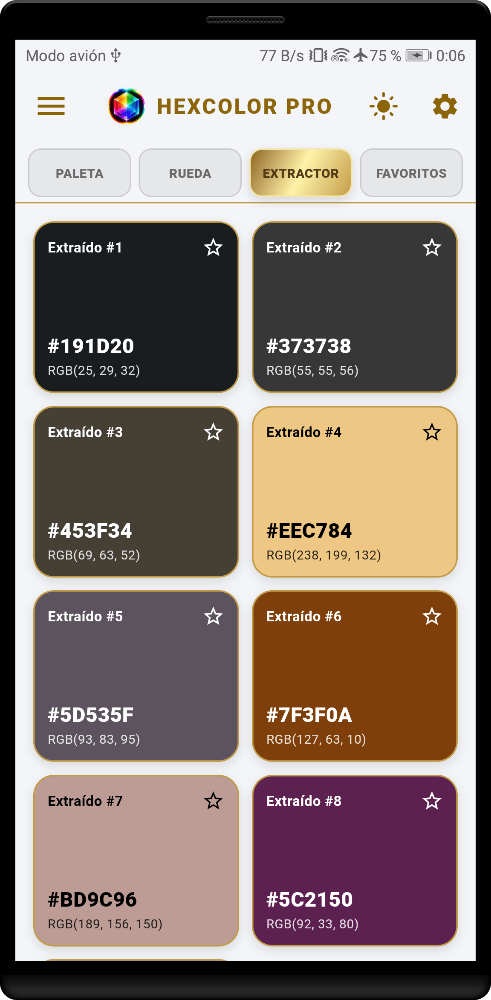&nbsp;   

---

# ⭐ 6. Gestión de Favoritos y Creador de Paletas

- **Sincronización en Tiempo Real**: `FavoritesManager` unificado para guardar y eliminar colores con 1 solo toque (botón de estrella).

- **Crear Paleta de Favoritos**: Agrupa tus colores favoritos guardados para previsualizarlos juntos como una paleta combinada.

- **Normalización Hex**: Almacenamiento unificado en formato mayúsculas `#RRGGBB` previniendo duplicados.

 
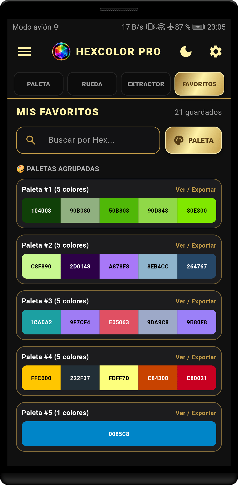&nbsp; 
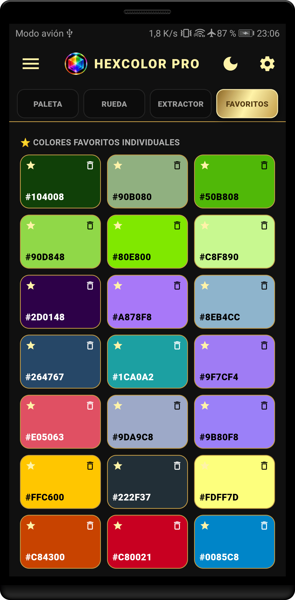&nbsp;&nbsp;&nbsp;
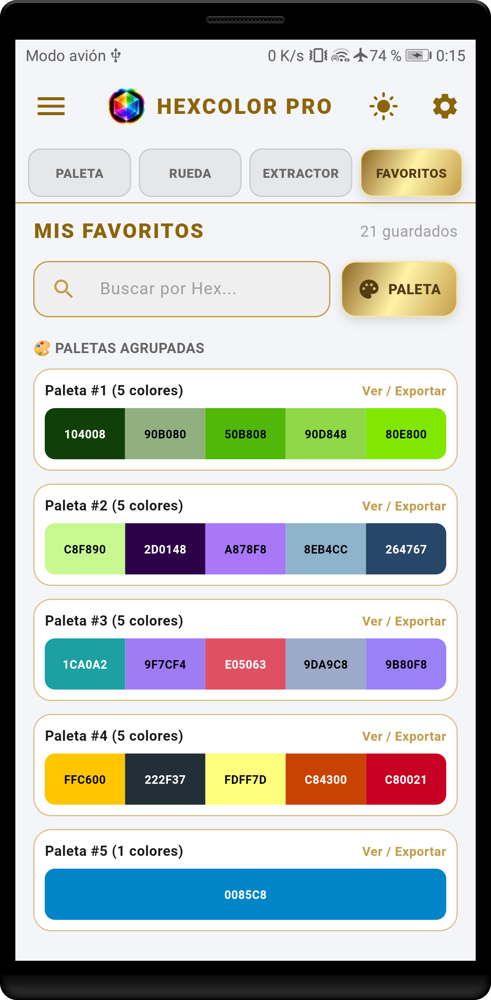&nbsp; 
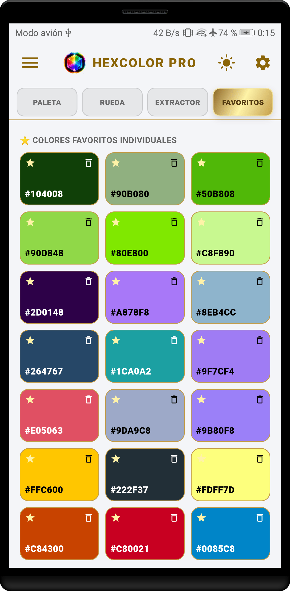&nbsp;   

---

# 📤 7. Exportación Multiformato
Exporta tus paletas con un toque a los formatos más utilizados en desarrollo e ilustración:

- **Variables CSS** (`--color-1: #FF5733;`)

- **Arreglo JSON** (`["#FF5733", "#33FF57"]`)

- **Android XML** (`<color name="palette_1">#FF5733</color>`)

- **Tabla CSV** (Para Excel, Figma y hojas de cálculo)

 
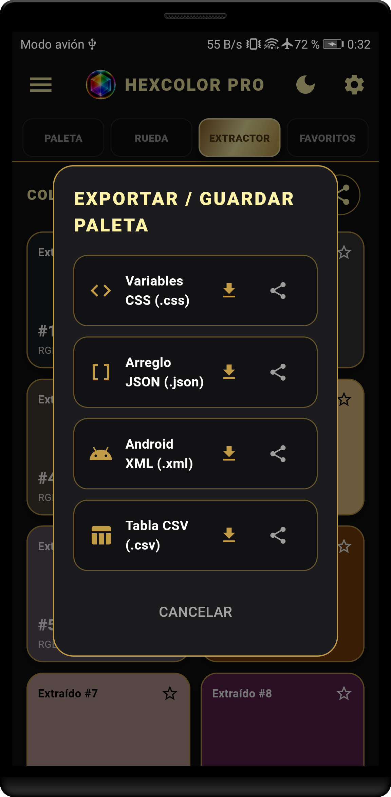&nbsp; 
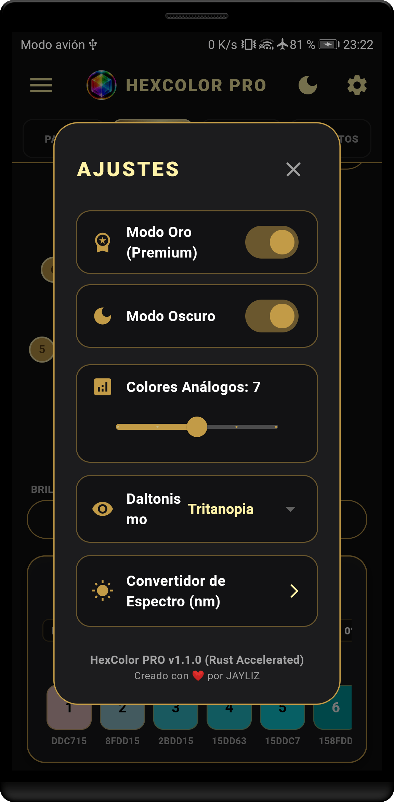&nbsp;
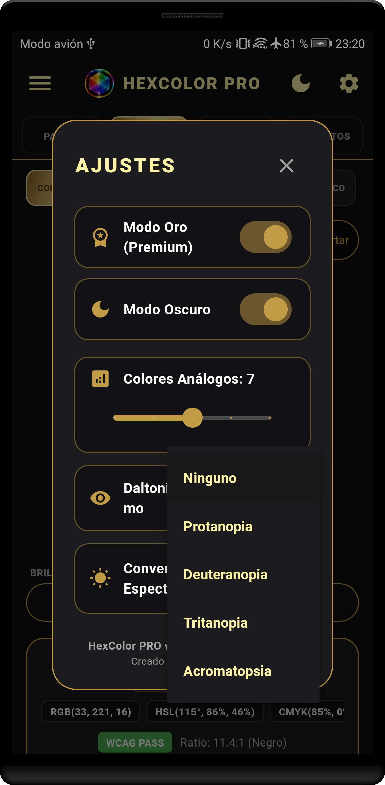&nbsp;&nbsp;&nbsp; 
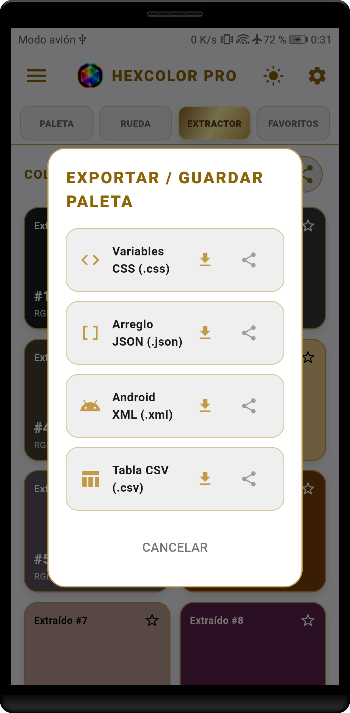&nbsp;   

---

# 👨‍💻 Autor y Licencia

Desarrollado con ❤️ por **Jaypsmall**.

Licencia PRO - Todos los derechos reservados.
